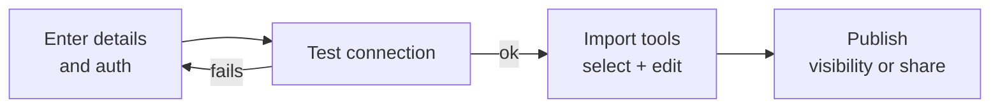
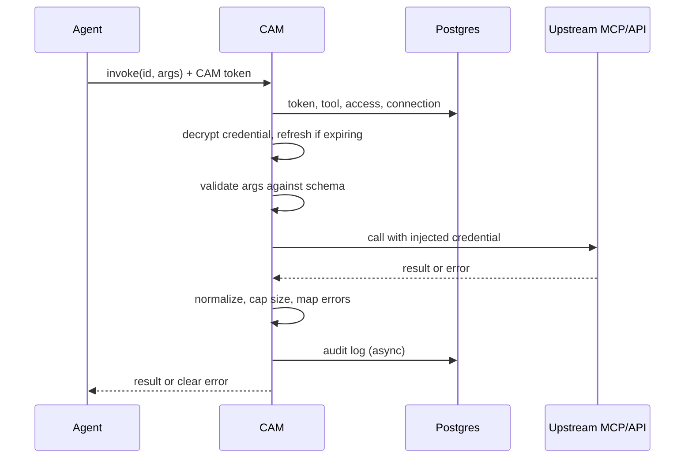
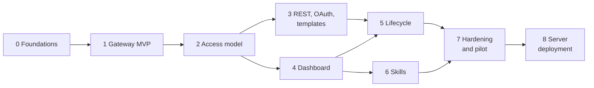

# Central Agent Management (CAM) — Architecture

Sep 24, 2026 · @Anurag

## Overview

CAM is an internal hub where agents (Claude Code, Codex, Cursor, custom agents) use tools, MCPs and skills through one connector, instead of each agent installing and configuring them separately. An agent does not fetch a tool from CAM; it calls through CAM, and CAM executes the call.

Today every agent keeps its own MCP configs, API keys and skills. They are duplicated and drift out of sync, and there is no central record of who called what. CAM fixes that by putting services, credentials, access and audit in one place.

**Goals**

- One connector per agent: a single `cam` MCP tool gives access to every service and skill the user is allowed to use.
- Works across harnesses: CAM is an MCP server, so any MCP-capable agent can use it.
- Central credentials: agents never see tokens or keys; CAM injects them at call time.
- Sharing: users can share their own services with other users.
- Full audit: every call is logged with the real user and the calling agent.

**Non-goals (for now)**

- Narrowing tool permissions. CAM is a pass-through: what a tool can do is decided by the tool or MCP owner.
- Approval steps before calls.
- A public launch. CAM is internal to IndiaMART at first, but built to be public-ready (see Public-readiness).
- Running skill scripts, or running skills as sub-agents.
- Search ranking. The catalog starts under 50 tools, so agents list and pick.

## Core concepts

CAM has four building blocks: a **service** (an MCP server or REST API), its **tools**, a **connection** (a credential bound to a service for an owner) and a **skill** (text instructions).

**Pass-through model.** CAM only decides whether a user can reach a service. Once a call is allowed, it runs with whatever the credential and the upstream tool allow. CAM does not add or narrow read/write scopes.

### Service tiers

| Tier | Registered by | Credential | Who can use it | Examples |
| --- | --- | --- | --- | --- |
| Global | Admin | One org credential | Everyone, or specific users set by the admin | Redash, PNS, Windmill, GKE |
| Template | Admin defines it once | Each user connects their own | Users the admin allows; each user can share their own connection | Notion (Gmail later) |
| Personal | Any user | The owner's credential | The owner, plus users they share with | A team's internal API |

A template avoids 40 slightly different Gmail entries: there is one definition, and users just click Connect.

### Naming

Users log in with their email. The part before `@` is their handle, and IDs use `/` as the separator so parsing is never ambiguous.

| Kind | ID format | Example |
| --- | --- | --- |
| Global tool | `global/<service>/<tool>` | `global/redash/run_query` |
| Template or personal tool | `<handle>/<service>/<tool>` | `anurag.upadhyay2/gmail/send` |
| Global skill | `global/<skill>` | `global/pns-analytics` |
| Personal skill | `<handle>/<skill>` | `anurag.upadhyay2/review-checklist` |

A user's personal service slug cannot reuse a template's slug, so `<handle>/gmail` always means one thing.

## Identity, access and sharing

Admins create every account, and agents act on behalf of the account whose CAM token they carry.

**Accounts**

- Admins create person or team accounts. There is no SSO.
- Login is email and password. The password stays as the admin set it, and only admins can change or reset it.
- Team accounts share one login. Audit logs then show the team, not the individual; per-person token labels (below) partly offset this.

**CAM tokens (for agents)**

- A user generates a token in the dashboard and adds the CAM MCP to their agent with it.
- Each token has a label, such as `rahul-laptop` or `priya-codex`, which appears in audit logs.
- Only a hash of the token is stored. Tokens can be revoked individually.
- The dashboard uses a separate login: an HTTP-only session cookie with CSRF protection.

**Access rules**

- Global services and templates: the admin sets visibility to everyone or to specific users.
- Personal services and template connections: the owner can share with specific users and remove access at any time.
- Sharing is all-or-nothing per service. The person you share with can do anything your credential allows, including acting as you. The dashboard states this when sharing.
- Access is not re-shareable: a user cannot pass on access that was shared with them.

**Deactivation**

Deactivating a user takes effect immediately:

- All their CAM tokens are revoked.
- Their personal services and template connections are disabled, so shares from them stop working.
- Anyone who used a shared service gets: "This service is no longer available: its owner's account is deactivated."
- Their audit history is kept.

## The cam tool and discovery

Agents see a single MCP tool, `cam`, and use it to list, describe and invoke tools and to load skills. With under 50 tools at launch, there is no search engine: the agent reads the list and picks.

| Action | Input | Returns |
| --- | --- | --- |
| `list_services` | — | Services this user can reach, one line each |
| `list_tools` | `service` | That service's enabled tools, one line each |
| `describe` | `id` | The tool's full input schema |
| `invoke` | `id`, `args` | The tool's result, or a clear error |
| `list_skills` | — | Skills this user can see, marked unavailable where requirements are unmet |
| `load_skill` | `id` | The skill's SKILL.md instructions |
| `read_skill_file` | `id`, `path` | One reference file from the skill |

**Routing: making the agent use CAM**

- **MCP server instructions**, sent when the agent connects, tell it to use `cam` for any external data, service or action.
- **A per-user tool description**: CAM builds the `cam` tool's description from the caller's token, listing their services and skills with one-liners, e.g. "Available: redash, pns, gke, gmail (yours), jira (shared by rahul)". The agent always knows what is reachable.
- **An optional CAM skill** for harnesses that support skills, with richer guidance. Skills are harness-specific, so routing must not depend on it.
- Remove direct MCPs that duplicate CAM services (for example, a direct Gmail MCP) from the agent. Otherwise the agent may bypass CAM and its audit log.

**Growing past \~100 tools** — add keyword search, then embeddings if needed, behind a new `search` action. Existing actions stay the same.

## Service registration

Every service is registered from an MCP URL or a REST URL and goes through the same four steps: connect, test, import tools, publish.



A failed test shows the exact error and nothing is saved.

**MCP URL**

- Transports: Streamable HTTP, plus the older SSE transport.
- CAM runs `initialize` and `tools/list`, then stores each tool's name, description and input schema.
- stdio MCPs cannot be registered directly. An admin runs them behind a stdio-to-HTTP bridge (`mcp-proxy` or `supergateway`) and registers that URL.

**REST URL**

- With an OpenAPI or Swagger spec: each endpoint becomes a tool (`operationId` → name, parameters and body → input schema, summary → description). For large specs, the owner picks which endpoints to import.
- Without a spec: the owner defines each tool by hand (method, path, parameters, body schema, description).

**Auth types**

| Type | Used for |
| --- | --- |
| None | Internal MCPs on the trusted network |
| Static header / bearer | Windmill, Grafana, most internal MCPs |
| API key (header or query) | REST APIs |
| Basic | Older REST APIs |
| OAuth (authorization code + PKCE) | Notion and other hosted services; CAM stores and refreshes tokens |

**Tool selection and descriptions**

- At import, the admin (global and template) or owner (personal) unchecks tools to leave out. Excluded tools cannot be listed, described or invoked.
- Selection can be changed later from the dashboard.
- Descriptions can be overridden and tags added, since upstream descriptions are often weak.

**Re-sync and new tools**

- Re-sync runs on a schedule, on the MCP's `list_changed` notification, or when the owner clicks Refresh.
- New tools on global services and templates arrive as pending review and stay hidden until an admin approves them.
- New tools on personal services are enabled automatically.
- Tools removed upstream are marked removed, not deleted, so old audit entries still resolve.

**Lifecycle**

- Health: healthy, failing or needs reconnect, from the last call and periodic checks.
- Credential rotation without re-registering.
- Disable or delete: shares stop working and agents get "service unavailable"; audit history is kept.

## Invoke flow

Each `invoke` passes through ten steps inside CAM. CAM never retries a failed call, and the default timeout is 60 seconds.



Example: user `anurag.upadhyay2`, using Claude Code, calls `rahul/gmail/send`, which is Rahul's Gmail shared with Anurag.

1. **Authenticate.** Look up the CAM token and check the user is active. Record the agent name and version from MCP `clientInfo`, or from the `X-CAM-Agent` header for non-MCP callers.
2. **Parse.** Read the action, tool ID and args. List and describe actions stop after the access filter.
3. **Resolve the tool.** Split the ID into owner, service and tool. The tool must exist, be enabled and be active.
4. **Check access.** For global services, the caller must be in the visibility list or it must be set to everyone. For template or personal services, the caller must be the owner or hold an active share. The service must be enabled and connected, and the owner active.
5. **Resolve the credential.** Global uses the org credential; template and personal use the owner's credential, so here Rahul's token. Decrypt it and refresh an OAuth token that is about to expire.
6. **Validate args** against the stored input schema, so the agent gets a precise error and can fix its call.
7. **Dispatch.** For MCP, reuse a pooled session keyed by service and credential, then send `tools/call`. For REST, build the request from the tool definition and inject the credential.
8. **Process the response.** Normalize MCP content blocks and REST bodies into one shape. Truncate any response over 50,000 tokens (the default cap, estimated at about 4 characters per token and changeable per service) with a note, e.g. "truncated: 12,400 rows, showing first 200. Add filters or a limit."
9. **Write the audit log** asynchronously, with a local buffer so entries are not lost.
10. **Return** the result. Errors come back as tool results with `isError`, not protocol failures, so the agent can read them.

**Error messages**

| Condition | What the agent sees |
| --- | --- |
| Invalid or expired CAM token | "Invalid or expired CAM token. Generate a new one in the dashboard." |
| Unknown, disabled or inaccessible tool | "Tool not found or not available." |
| Owner's OAuth token expired and refresh failed | "Rahul's Gmail connection has expired. Rahul needs to reconnect it in the CAM dashboard." The service is marked needs reconnect. |
| Owner deactivated | "This service is no longer available: its owner's account is deactivated." |
| Upstream 401/403 | "Credential rejected. Owner needs to reconnect." |
| Upstream 400/404 or MCP `isError` | The upstream error text, passed through |
| Upstream 429 | "Rate limited by \<service>, retry later." |
| Upstream 5xx or 60s timeout | "\<service> is unavailable or timed out." |

The 60-second default can be changed per service. Some harnesses have their own tool-call timeout, which may be shorter; test this with the prototype.

## Audit logging

Every CAM action is logged with the real user and the calling agent, and invoke args are logged in full for debugging.

| Field | Notes |
| --- | --- |
| Time |  |
| User and token | The token label distinguishes people on team accounts |
| Agent name and version | From MCP `clientInfo` (claude-code, codex, cursor…) or the `X-CAM-Agent` header; self-reported, so good for debugging but not proof of identity |
| Action | `list_services`, `list_tools`, `describe`, `invoke`, `list_skills`, `load_skill`, `read_skill_file` |
| Service, connection and owner | The owner is stored directly, so "calls on my services" is a fast query |
| Tool name or skill version | Kept as text, so it survives later tool changes |
| Args | Full |
| Status, error code and message |  |
| Latency, response size, truncated flag | Response bodies are not logged |

**Safeguards for full args**

- Credentials never appear in logs: CAM injects them after logging args.
- Admins see all logs. Users see their own calls, plus calls others made through services they own.
- Logs are kept for 30 days. Monthly partitions let old logs be dropped cheaply.

## Skills

Skills live in CAM beside the tools they use and are served to agents as text. Any MCP-capable harness can use them, not only Claude.

**What a skill is**

- `SKILL.md` with frontmatter (`name`, `description`, optional `requires`) and instructions.
- Optional reference files, loaded only when the agent asks for them.
- Text only for now: `.md`, `.txt`, `.json`, `.yaml`, `.csv`. Script files are rejected at upload with a clear message.

**How agents use them**

1. The per-user `cam` description lists skills with one-line descriptions, so the agent knows when one applies.
2. `load_skill` returns the instructions.
3. `read_skill_file` returns one reference file when needed.

A skill can point at CAM tools, for example "use `global/pns/run_query`", so the agent moves straight from instructions to the right tool.

**Tiers and access**

- Global skills: added by admins, visible to everyone or specific users.
- Personal skills: added by any user, shareable with specific users.
- Shared skills always show their author. A skill is instructions the agent follows, so a careless or malicious one can misuse other tools.

**Dependencies**

- `requires` lists the services a skill needs, e.g. `requires: [global/pns]`.
- If the user lacks access, the skill is listed as unavailable with the reason, e.g. "unavailable: requires global/pns (no access)".
- `load_skill` on an unavailable skill returns that message instead of the instructions. The dashboard still lets the user read it.

**Authoring and versions**

- Upload a zip or folder, or edit in the dashboard's markdown editor with preview.
- Upload checks that SKILL.md exists with a name and description, and enforces file-size and file-count limits.
- Every save creates a new version, with history, diff and one-click rollback. Agents always get the latest, and the audit log records the version loaded.

**Later:** scripts registered as CAM tools that run server-side; git sync for skills; running skills as sub-agents inside CAM.

## Dashboard

The dashboard has seven screens for every user and six more for admins. Admins also get everything users get.

**User screens**

| Screen | Purpose |
| --- | --- |
| Login | Email and password, as set by the admin |
| My services | Everything the user can reach, grouped as Global, Connected templates, My services and Shared with me, with health badges; unconnected templates show a Connect button |
| Register service | Wizard: type → details → auth → test connection → select tools and edit descriptions → timeout and size cap → save |
| Service detail | Tabs for Tools (toggle, edit, re-sync), Connection (health, reconnect, rotate), Sharing (owner only, with the all-or-nothing warning), Activity and Settings |
| Skills | Browse, upload, edit with preview, version history and rollback, share; unavailable skills show what access is missing |
| Activity log | My calls and calls on my services; filter by date, agent, service and status; row detail shows full args and the error |
| Agent setup | Generate labelled CAM tokens, copy ready-made configs for Claude Code, Codex, Cursor and generic MCP, revoke tokens, see recently connected agents |

**Admin screens**

| Screen | Purpose |
| --- | --- |
| Users and teams | Create, reset password, deactivate; per-user access, tokens and activity |
| Global services | Register with the org credential; set visibility to everyone or specific users |
| Templates | Define URL, OAuth app, tools and descriptions; set who may connect; see each user's connection status |
| Review queue | Approve new tools found on re-sync for global services and templates |
| Org overview | Service health and the global audit log; usage metrics to be defined later |
| Settings | Default timeout (60s), response cap (50,000 tokens), log retention (30 days), URL allowlist |

Users only see the tabs they may use. Someone with shared access sees Tools and their own Activity, not Sharing or Connection.

## Data model

The key idea is that a **connection** is a credential bound to a service for an owner, and one table covers all three tiers. Sharing always means sharing a connection.

| Tier | `services` rows | `connections` rows |
| --- | --- | --- |
| Global | 1, no owner | 1, no user: the org credential |
| Template | 1, no owner | 1 per user who connected |
| Personal | 1, owned by the user | 1, owned by the same user |

**Tables**

| Table | Key columns |
| --- | --- |
| `users` | id, email (unique), handle (unique, from email), display\_name, password\_hash (argon2), role (admin/user), kind (person/team), status, deactivated\_at |
| `cam_tokens` | id, user\_id, label, token\_hash, token\_prefix, last\_used\_at, revoked\_at |
| `services` | id, tier, owner\_user\_id, slug, name, description, kind (mcp/rest), url, transport, spec\_url, auth\_type, auth\_config (non-secret JSONB), visibility (all/restricted), timeout\_ms, response\_cap\_tokens, status, health, last\_synced\_at |
| `service_visibility` | service\_id, user\_id |
| `tools` | id, service\_id, name, upstream\_name, description, description\_override, tags, input\_schema, rest\_binding (method, path, param placement), enabled, status (active/pending\_review/removed\_upstream) |
| `connections` | id, service\_id, user\_id (null = org credential), secret\_enc, refresh\_enc, key\_version, expires\_at, status (connected/needs\_reconnect/disabled); unique per service and user |
| `shares` | id, connection\_id, grantee\_user\_id, created\_at, revoked\_at |
| `skills` | id, tier, owner\_user\_id, slug, name, description, visibility, current\_version\_id |
| `skill_versions` | id, skill\_id, version, created\_by, notes |
| `skill_files` | version\_id, path, content |
| `skill_requires` | skill\_id, service\_id |
| `skill_visibility`, `skill_shares` | Same pattern as for services |
| `audit_logs` | ts, user\_id, token\_id, agent\_name, agent\_version, action, service\_id, connection\_id, owner\_user\_id, tool\_name, skill\_version\_id, args, status, error\_code, error\_message, latency\_ms, response\_bytes, truncated; indexed on (user\_id, ts), (owner\_user\_id, ts), (service\_id, ts); partitioned monthly |
| `oauth_states` | state, user\_id, service\_id, pkce\_verifier, expires\_at |
| `settings` | key, value |

Secrets are encrypted with AES-256-GCM. The key lives outside the database in an env var or key file, and `key_version` allows rotation. MCP sessions are held in memory, not in the database.

**How IDs resolve**

- `global/redash/run_query`: the global service `redash`, its single connection, allowed if visibility is all or the caller is in `service_visibility`.
- `rahul/gmail/send`: the template (or Rahul's personal service) `gmail`, the connection for Rahul, allowed if the caller is Rahul or holds an active share, the connection is connected and Rahul is active.

## Tech stack and deployment

CAM is one Python service (FastAPI) with a React dashboard, backed by local Postgres, and built to move to a server by changing configuration only.

| Layer | Choice |
| --- | --- |
| Backend framework | FastAPI (async throughout) |
| MCP | Official Python `mcp` SDK: server for agents, client for upstream MCPs |
| Database | Postgres 16 in Docker; SQLAlchemy 2 (async) + asyncpg; Alembic migrations |
| HTTP client | httpx (async) |
| Validation | Pydantic for API inputs; jsonschema for tool args |
| Secrets and passwords | `cryptography` AES-GCM; argon2-cffi |
| OAuth | Authlib |
| OpenAPI import | prance / openapi-spec-validator |
| Background jobs | APScheduler (health checks, re-sync, log partitions); Procrastinate if jobs grow |
| Frontend | React + Vite + TypeScript, shadcn/ui, TanStack Query and Table, react-hook-form + Zod, React Router, Recharts |
| API types | Typed client generated from FastAPI's OpenAPI with openapi-typescript |
| Tooling | uv, ruff, pyright, docker-compose |

**Rules**

- Nothing blocking in the request path: no sync DB drivers or `requests`. One blocking call stalls every agent's calls.
- Business logic lives in service modules. JSON routes and the MCP gateway are thin layers over them.

**Layout**

```
cam/
  gateway/      MCP server: the cam tool and its actions
  upstream/     MCP client pool and REST executor
  access/       tool resolution, access checks, credential resolution
  connections/  encryption, OAuth connect and refresh
  registry/     service registration, tool import, re-sync
  skills/       upload, validation, versions
  audit/        async log writer
  api/          dashboard JSON API
  jobs/         scheduled jobs
  web/          React dashboard
  db/           models and migrations
```

**Deployment**

- One container. FastAPI serves `/mcp` for agents, `/api` for the dashboard, and the built React files from the same origin.
- Local: `docker compose up` runs Postgres and CAM. During development, Vite's dev server proxies to FastAPI.
- Later: the same image runs on GKE, with Postgres on Cloud SQL or in the cluster. Only env vars change.
- stdio MCPs run in their own containers behind a stdio-to-HTTP bridge.

## Implementation spec

This section fixes the contracts and rules an implementer needs, so nothing in the build depends on guessing. Where it conflicts with an earlier section, this section wins.

### Launch scope

- **MCP passthrough covers tool calls only.** Results may contain text, JSON (`structuredContent`) and images. Resources, prompts, sampling and elicitation are not proxied. Audio, binary blobs and resource links are replaced with a one-line text note.
- **Images:** at most 5 per response and 5 MB each; anything beyond is replaced with a note. Images do not count toward the token cap.
- **Templates at launch:** Notion (hosted MCP with MCP-spec OAuth). Gmail is deferred; Gmail appears elsewhere in this doc only as an illustration.

### Agent authentication

- Agents connect to `<CAM_BASE_URL>/mcp` over Streamable HTTP, with stateful sessions (`Mcp-Session-Id`).
- Every request carries `Authorization: Bearer cam_<token>`, where the token is 32 random bytes, base62-encoded. `token_prefix` stores the first 8 characters after `cam_`.
- CAM looks tokens up by SHA-256 hash. A missing, revoked or unknown token gets HTTP 401 before any MCP session starts.
- The agent name and version come from `clientInfo` in `initialize`. Non-MCP callers send `X-CAM-Agent`.
- Agent setup shows copy-ready configs. For Claude Code: `claude mcp add --transport http cam <CAM_BASE_URL>/mcp --header "Authorization: Bearer <token>"`. For Cursor and other JSON-config clients: `{"mcpServers":{"cam":{"url":"<CAM_BASE_URL>/mcp","headers":{"Authorization":"Bearer <token>"}}}}`. Verify each harness's current config syntax against its docs when building the screen.

### The cam tool contract

CAM exposes exactly one MCP tool, named `cam`, with this input schema:

```json
{
  "type": "object",
  "properties": {
    "action": {"type": "string", "enum": ["list_services", "list_tools", "describe", "invoke", "list_skills", "load_skill", "read_skill_file"]},
    "service": {"type": "string", "description": "Service ID for list_tools, e.g. global/redash"},
    "id": {"type": "string", "description": "Tool ID (describe, invoke) or skill ID (load_skill, read_skill_file)"},
    "args": {"type": "object", "description": "Tool arguments for invoke"},
    "path": {"type": "string", "description": "Reference file path for read_skill_file"}
  },
  "required": ["action"]
}
```

Every non-invoke action returns one text content block holding JSON, and the same object as `structuredContent`:

| Action | Result |
| --- | --- |
| `list_services` | `{"services":[{"id":"global/redash","name":"Redash","description":"…","tier":"global","owner":null,"shared_by":null,"health":"healthy","tool_count":12}]}` |
| `list_tools` | `{"service":"global/redash","tools":[{"id":"global/redash/run_query","description":"…"}]}` |
| `describe` | `{"id":"…","description":"…","input_schema":{…}}` |
| `invoke` | The upstream content blocks, passed through; plus a text note if truncated |
| `list_skills` | `{"skills":[{"id":"global/pns-analytics","name":"…","description":"…","author":"…","available":true,"unavailable_reason":null}]}` |
| `load_skill` | `{"id":"…","version":3,"content":"<SKILL.md body>","files":["references/schema.md"]}` |
| `read_skill_file` | `{"id":"…","path":"…","content":"…"}` |

**Server instructions** (sent at `initialize`): "CAM is your gateway to external services, data and skills. For any task that needs an external system (Redash, PNS, Windmill, GKE, Notion and others listed in the cam tool), use the cam tool: list\_services, then list\_tools, describe, invoke. Check list\_skills for relevant know-how before starting a task in a listed domain."

**Per-user description:** built on each `tools/list` from the caller's access: a fixed first line, then one line per service and skill. If it would exceed 2,000 characters, list names only. When a user's access changes (share added or removed, service enabled or disabled, skill added), CAM sends `notifications/tools/list_changed` to that user's open sessions.

### Errors

Every CAM error is a tool result with `isError: true` and one text block holding `{"error":{"code":"…","message":"…","service":"…","retryable":false}}`.

| Code | When | Retryable |
| --- | --- | --- |
| `NOT_FOUND` | Unknown ID, excluded tool, or no access (never reveal which) | No |
| `INVALID_ARGS` | Args fail schema validation; message names the field | No |
| `CONNECTION_EXPIRED` | OAuth refresh failed; message names the owner | No |
| `OWNER_DEACTIVATED` | Shared service whose owner is deactivated | No |
| `SERVICE_DISABLED` | Service disabled or deleted | No |
| `SKILL_UNAVAILABLE` | Skill whose required services the user cannot access | No |
| `UPSTREAM_AUTH` | Upstream 401/403 | No |
| `UPSTREAM_ERROR` | Upstream 400/404 or MCP `isError`; upstream text passed through | No |
| `UPSTREAM_RATE_LIMITED` | Upstream 429 | Yes |
| `CAM_RATE_LIMITED` | CAM's own per-token limit hit | Yes |
| `TIMEOUT` | No upstream answer within the timeout | Yes |
| `UPSTREAM_UNAVAILABLE` | Upstream 5xx or connection failure | Yes |
| `INTERNAL` | Unexpected CAM failure; details go to CAM's own logs | Yes |

`retryable` is advice to the agent. CAM itself never retries.

### Truncation

- Tokens are estimated as characters ÷ 4 over all text and JSON content.
- If the result is (or contains, at the top level) a JSON array, keep whole leading items that fit and drop the rest. Otherwise cut text at the last newline before the limit.
- Append: "\[CAM: response truncated — showing N of M items (\~50,000 token cap). Narrow the request with filters or a limit.\]" For plain text, say "showing the first \~50,000 tokens".
- Set `truncated = true` in the audit log.

### Upstream session pool

- One MCP session per (service, connection), created on first use. Requests on it run concurrently.
- Sessions idle for 10 minutes are closed. Credential rotation or reconnect closes the session at once.
- If establishing or re-establishing a session fails, CAM may reconnect once. Once `tools/call` has been sent, a failure is returned as an error and never re-sent.

### OAuth

- **Plain OAuth2** (admin-registered app): the admin enters authorize URL, token URL, scopes, client ID and client secret. The secret is stored encrypted on the service.
- **MCP-spec OAuth:** CAM discovers the authorization server from the MCP server's protected resource metadata (RFC 9728) and authorization server metadata (RFC 8414), registers itself via dynamic client registration (RFC 7591) and stores the issued client credentials, encrypted, on the service.
- Both use authorization code with PKCE (S256). Redirect URI: `<CAM_BASE_URL>/api/oauth/callback`. `oauth_states` rows are single-use and expire after 10 minutes.
- **Refresh:** if `expires_at` is less than 60 seconds away, refresh under `SELECT … FOR UPDATE` on the connection row. A concurrent caller waits and then uses the new token. A failed refresh sets the connection to `needs_reconnect` and returns `CONNECTION_EXPIRED`.

### URL policy (SSRF protection)

Personal services cannot target private or metadata addresses, unless an admin has put that host or range on the allowlist. Services registered by admins (global and templates) are not restricted.

- Only `http` and `https` URLs are accepted.
- Blocked ranges: `127.0.0.0/8`, `::1`, `10.0.0.0/8`, `172.16.0.0/12`, `192.168.0.0/16`, `169.254.0.0/16` (includes `169.254.169.254`), `100.64.0.0/10`, `0.0.0.0/8`, `fc00::/7`, `fe80::/10`, and the hostname `metadata.google.internal`.
- **Admin allowlist** (`url_allowlist` table, managed in admin Settings): entries are hostnames or CIDR ranges, each with a note and the admin who added it. A URL whose host or resolved IP matches an entry is exempt from the block.
- The check runs at registration **and on every request**: resolve the hostname, validate every resolved IP, then connect to a validated IP. This defeats DNS rebinding.
- Upstream redirects are not followed automatically. Each redirect target is validated the same way, up to 3 hops.

### Security details

- **Login:** argon2id hashes. 5 failed attempts within 15 minutes lock the account for 15 minutes, and login is rate-limited per IP.
- **Dashboard session:** HTTP-only cookie, `Secure` under HTTPS, `SameSite=Lax`, expiring after 12 hours idle. Mutating requests need an `X-CSRF-Token` header matching the CSRF cookie.
- **CAM rate limit:** 120 `invoke` calls per minute per token by default, configurable. Excess calls get `CAM_RATE_LIMITED`.
- **Secrets:** never logged and never returned by the API; the dashboard shows only the last 4 characters.
- **Encryption keys:** 32-byte keys in `CAM_ENCRYPTION_KEYS` as `v1:<base64>,v2:<base64>`, with `CAM_ENCRYPTION_KEY_CURRENT` naming the active one. Each org has its own data key, encrypted by the current master key (see Public-readiness); rotating a master key re-wraps only the data keys. **Back up the keys offline.** Losing them means every stored credential must be re-entered.
- **First admin:** created only by the CLI command `cam create-admin`, which is kept after the dashboard ships.

### Delete semantics

| Action | Effect |
| --- | --- |
| Delete a service | Soft delete: status `deleted`, secrets wiped, connections disabled, shares revoked, pooled sessions closed. Tools and audit rows are kept; the slug stays reserved. |
| Deactivate a user | Tokens revoked, their connections disabled (so their shares stop), sessions closed. Users are never hard-deleted; the handle stays reserved. |
| Revoke a share | `revoked_at` set; takes effect on the next call. |
| Tool removed upstream | Status `removed_upstream`; never deleted. |

### Data model additions

- New table `orgs`: id, slug, name, settings (JSONB), data\_key\_enc, created\_at. Every other table gains `org_id`, and per-org uniqueness applies to handles and slugs (see Public-readiness).
- `services.auth_secret_enc`: the encrypted OAuth client secret, or the client credentials from dynamic registration.
- `services.status` gains `deleted`.
- New table `url_allowlist`: id, pattern (hostname or CIDR), note, created\_by, created\_at.
- New table `login_attempts`: user\_id or email, ip, ts, success; used for lockout.

### Dashboard API

All routes are JSON under `/api`. Lists use cursor pagination (`?cursor=&limit=`, default 50, max 200). Errors use `{"error":{"code":"…","message":"…"}}`. `/api/admin/*` requires the admin role.

| Area | Endpoints |
| --- | --- |
| Auth | `POST /auth/login`, `POST /auth/logout`, `GET /auth/me` |
| Tokens | `GET /tokens`, `POST /tokens` (returns the raw token once), `DELETE /tokens/{id}` |
| Services | `GET /services` (grouped as on My services), `POST /services` (personal), `POST /services/test` (test a draft), `GET/PATCH/DELETE /services/{id}`, `POST /services/{id}/resync`, `GET /services/{id}/tools`, `PATCH /tools/{id}` |
| Connections | `POST /services/{ref}/connect` (starts OAuth or stores a secret; accepts UUID or `global/<slug>`; also aliased at `POST /services/{owner}/{slug}/connect`), `GET /oauth/callback`, `POST /connections/{id}/rotate` |
| Shares | `GET/POST /connections/{id}/shares`, `DELETE /shares/{id}` |
| Skills | `GET/POST /skills`, `GET/PATCH/DELETE /skills/{id}`, `POST /skills/{id}/versions`, `GET /skills/{id}/versions`, `POST /skills/{id}/rollback`, `GET/POST /skills/{id}/shares` |
| Audit | `GET /audit` (filters: date, agent, service, status, scope=mine or my\_services), `GET /audit/{id}` |
| Admin | `/admin/users` (CRUD, `reset-password`, `deactivate`), `/admin/services` (global and templates, visibility), `/admin/review-queue` (list, approve), `/admin/url-allowlist`, `/admin/settings` |

### Configuration

| Env var | Default | Notes |
| --- | --- | --- |
| `CAM_ENV` | `dev` | `dev` or `prod` |
| `CAM_BASE_URL` | `http://localhost:8000` | Used for OAuth redirects and config snippets |
| `CAM_DATABASE_URL` | — | Required |
| `CAM_ENCRYPTION_KEYS` | — | Required |
| `CAM_ENCRYPTION_KEY_CURRENT` | — | Required |
| `CAM_SESSION_SECRET` | — | Required; signs dashboard sessions |
| `CAM_DEFAULT_TIMEOUT_S` | `60` |  |
| `CAM_DEFAULT_RESPONSE_CAP_TOKENS` | `50000` |  |
| `CAM_LOG_RETENTION_DAYS` | `30` |  |
| `CAM_RATE_LIMIT_PER_MIN` | `120` | Per token |
| `CAM_HEALTHCHECK_INTERVAL_S` | `300` |  |
| `CAM_RESYNC_INTERVAL_S` | `3600` |  |
| `CAM_SESSION_IDLE_TIMEOUT_S` | `600` | Upstream MCP sessions |
| `CAM_LOG_LEVEL` | `INFO` | CAM's own logs |

Timeout, cap and retention can also be changed at runtime in the `settings` table, which overrides the env defaults.

### Testing

- **Fixtures**, built in the repo:
  - A mock MCP server (Python `mcp` SDK) with a normal tool, a slow tool, a huge-response tool, an error tool, an image tool, and a way to add tools to trigger `list_changed`.
  - A mock REST API with an OpenAPI spec.
  - A mock OAuth server covering authorize, token, refresh, metadata and dynamic registration.
- **Unit tests:** ID parsing, access resolution, truncation, encryption, the URL policy checker.
- **Integration tests:** the full invoke flow against a real Postgres test database and the mocks.
- **Access-control matrix:** every org × tier × role × share state × deactivation state, including cross-org isolation, asserting allow or `NOT_FOUND`.
- **Phase tests:** each phase's "Done when" becomes an automated test, plus one manual check in Claude Code.
- CI blocks merges on failing tests. Target at least 90% coverage for `access/`, `connections/` and the URL policy.

## Public-readiness

CAM launches for IndiaMART only, but is built so it could become a multi-company product without a rewrite. Five rules apply from Phase 1. Everything else a public launch needs is deferred, at a cost of a few extra days now.

**1. Tenancy from day one**

- A new `orgs` table: id, slug, name, settings (JSONB), data\_key\_enc, created\_at.
- Every other table carries `org_id`. Every query and access check filters by the caller's org, taken from their token or session and never from request input.
- Uniqueness is per org: handles and service and skill slugs. Email stays unique across CAM, since a user belongs to one org.
- Tool and skill IDs don't include the org; the caller's org is implied.
- Launch with a single org, `indiamart`.

**2. Pluggable login**

- Authentication sits behind an `AuthProvider` interface (authenticate a login, return the user).
- Email and password is the first provider. SSO or self-signup can be added later as new providers without touching access control.

**3. Per-org encryption keys (envelope encryption)**

- Master keys stay in env vars as described under Security details.
- Each org has its own data key, stored encrypted by the current master key in `orgs.data_key_enc`. Credentials are encrypted with the org's data key.
- Rotating a master key re-wraps only the data keys. Destroying an org's data key makes its credentials unrecoverable, which gives clean offboarding.

**4. No IndiaMART-specific hardcoding**

- Server instructions, branding, example services and any allowed email domain come from `orgs.settings`, not from code.
- Code, templates and seed data stay org-neutral; IndiaMART's values live only in its org row.

**5. Network-agnostic upstream**

- Only the `upstream/` layer opens connections to services, through a transport interface.
- Today the transport is direct HTTP. Later, a connector running inside a customer's network could dial out to CAM, so a publicly hosted CAM never needs direct access to private networks.

**Deferred until a public launch is decided**

- Self-signup, email verification and SSO
- Per-org admin portals, plans, billing and usage limits
- A public service catalog or marketplace
- Compliance: India's DPDP Act, GDPR, Google's OAuth verification and security assessment for sensitive scopes
- Revisiting full-args audit logging, which becomes a liability with customer data
- The inside-network connector, and hosting outside IndiaMART's network

## Build plan

CAM is built in nine phases, and each ends with something working that can be tested. The riskiest part comes first: proving that an agent can call real tools through CAM. Every sub-phase follows the Implementation spec.



Phases 0 to 2 run in order. Phases 3 and 4 can overlap once 2 is done, and 5 and 6 can run in parallel after 4.

### Phase 0: Foundations

- [x] 0.1 Repo and tooling: `uv`, `ruff`, `pyright`, `pytest`, pre-commit hooks
- [x] 0.2 Local stack: `docker-compose` with Postgres 16 and a FastAPI app with a health endpoint
- [x] 0.3 Config from env vars (DB URL, encryption key, defaults); the key is never committed
- [x] 0.4 DB plumbing: async SQLAlchemy, Alembic migrations, a test database
- [x] 0.5 CI: lint, type check and tests on every push

**Done when:** `docker compose up` starts CAM and Postgres, and CI passes.

### Phase 1: Gateway MVP

An end-to-end slice with no dashboard; admin tasks use a CLI.

- [x] 1.1 Core tables, every one carrying org\_id, plus orgs with a default indiamart org: `users`, `cam_tokens`, `services`, `tools`, `connections`, `audit_logs`
- [x] 1.2 Security basics: per-org data keys wrapped by a master key, AES-GCM credential encryption with `key_version`, argon2 passwords, token generation storing only the hash
- [x] 1.3 Admin CLI: create a user, issue a token, register a global MCP with static-header auth
- [x] 1.4 Upstream MCP client: Streamable HTTP and SSE, `tools/list` import, session pool keyed by service and credential
- [x] 1.5 CAM MCP server: the `cam` tool with `list_services`, `list_tools`, `describe`, `invoke`; routing instructions; per-user tool description
- [x] 1.6 Invoke pipeline: authenticate, resolve, inject credential, validate args, 60s timeout, 50,000-token cap, error mapping, no retries, per-token rate limit
- [x] 1.7 Audit log: async writer with full args and the agent name from `clientInfo`

**Done when:** Claude Code, connected with a CAM token, lists and invokes tools on two real global MCPs (e.g. Windmill and Grafana), and every call appears in `audit_logs`.

### Phase 2: Access model

- [x] 2.1 Global visibility: everyone or specific users
- [x] 2.2 Personal services under `<handle>/<service>/<tool>`, registered through the CLI or API
- [x] 2.3 Sharing: the `shares` table, add and remove, checks at every step
- [x] 2.4 Deactivation: revoke tokens, disable connections, "owner deactivated" error
- [x] 2.5 Slug rules: unique slugs; personal slugs cannot reuse a template slug; URL policy checker with the admin allowlist
- [x] 2.6 A thorough access-control test suite, including cross-org isolation, since this is the main security boundary

**Done when:** user B can use A's shared service, loses access immediately when the share is removed or A is deactivated, and never sees services they have no access to.

### Phase 3: REST services, OAuth and templates

- [x] 3.1 REST executor: build requests from `rest_binding`, inject the credential, normalize the response
- [x] 3.2 OpenAPI import with endpoint selection
- [x] 3.3 Manual REST tool definitions
- [x] 3.4 Auth types: none, header or bearer, API key, basic
- [x] 3.5 OAuth, both plain OAuth2 and MCP-spec OAuth (discovery and dynamic client registration): authorization code with PKCE, encrypted token storage, refresh before calls, "needs reconnect" error
- [x] 3.6 Templates: one admin definition, a connection per user, shareable connections

**Done when:** a REST API imported from OpenAPI works end to end, and two users each connect their own Notion through one template and call it through CAM.

### Phase 4: Dashboard

- [x] 4.1 Scaffold: React, Vite, TypeScript, shadcn/ui, a typed client generated from FastAPI's OpenAPI, UI served by FastAPI
- [x] 4.2 Dashboard auth behind the pluggable AuthProvider interface: HTTP-only session cookie with CSRF protection and login lockout
- [x] 4.3 User screens, in order: My services; Agent setup (tokens and configs); Service detail; Register wizard; Activity log
- [x] 4.4 Admin screens: users and teams, global services, templates, settings (including the URL allowlist)
- [x] 4.5 Retire the CLI except for bootstrapping the first admin

**Done when:** someone new can log in, connect Notion, generate a token and use CAM from Claude Code without the CLI.

### Phase 5: Lifecycle and background jobs

- [ ] 5.1 Job runner: APScheduler inside the app
- [ ] 5.2 Health checks from periodic checks and call results, with dashboard badges
- [ ] 5.3 Re-sync on a schedule, on `list_changed` and on Refresh; auto-enable for personal, pending review for global and templates; mark `removed_upstream`
- [ ] 5.4 Review queue screen with bulk approve
- [ ] 5.5 Credential rotation without re-registering
- [ ] 5.6 Log retention: monthly partitions, dropped after 30 days

**Done when:** a new upstream tool shows up correctly by tier, a broken service turns red in the dashboard, and old logs are removed automatically.

### Phase 6: Skills

- [ ] 6.1 Tables: `skills`, `skill_versions`, `skill_files`, `skill_requires`, visibility and shares
- [ ] 6.2 Upload: zip or folder, text files only, SKILL.md checks, size and count limits
- [ ] 6.3 Dashboard: browse, edit with preview, history, diff, rollback, sharing with author shown
- [ ] 6.4 `cam` actions: `list_skills`, `load_skill`, `read_skill_file`; unavailable marking; skills in the per-user description
- [ ] 6.5 Skill loads logged with the version

**Done when:** a global PNS skill loads in Claude Code and guides it to `global/pns/run_query`, and a user without PNS access sees it marked unavailable.

### Phase 7: Hardening and pilot

- [ ] 7.1 Security review with IndiaMART's security team: credential storage, key handling, access checks, full-args logs
- [ ] 7.2 Load test with many agents calling slow tools at once, to confirm nothing blocks
- [ ] 7.3 Harness checks for Claude Code, Codex and Cursor: tool-call timeouts, routing, configs
- [ ] 7.4 Onboarding and "register a service" guides
- [ ] 7.5 Pilot with one or two teams; fix issues and tune tool descriptions from the audit log

**Done when:** the pilot teams use CAM daily with no blocking issues, and the security review is signed off.

### Phase 8: Server deployment

- [ ] 8.1 Container image deployed to GKE with TLS
- [ ] 8.2 Postgres on Cloud SQL or in the cluster, with backups and a tested restore
- [ ] 8.3 Encryption key moved into a secret manager
- [ ] 8.4 Monitoring: CAM metrics and logs in Grafana, alerts on error rates and failing services
- [ ] 8.5 Org overview metrics chosen from pilot usage, then built
- [ ] 8.6 Company-wide rollout

**Done when:** CAM runs on the server, local installs are retired, and all teams can onboard.

## Decision log

These decisions are locked. An implementer must not change them without the owner's approval, even where an alternative looks better.

| Area | Decision | Rejected | Why |
| --- | --- | --- | --- |
| Core model | Pass-through: CAM controls reach, not scopes | Per-tool read/write scopes, approval steps | Tool owners already define permissions; keeps CAM simple |
| Tiers | Global, template, personal | Global and personal only | Templates avoid many near-duplicate entries for the same service |
| Identity | Admin-created accounts, email login | Google Workspace SSO | Simplest for an internal launch |
| Passwords | Set by admin; only admins change them; no forced change | Self-service changes | Simplicity for now |
| Team accounts | One shared login | Separate member logins | Simplicity; token labels identify people |
| Sharing | All-or-nothing per service, owner-controlled, not re-shareable | Scoped or tool-level shares | Follows from the pass-through model |
| Discovery | list → describe → invoke; the agent picks | Keyword or semantic search | Under 50 tools at launch; no embedding model available |
| Routing | MCP server instructions + per-user description; skill optional | A routing skill only | Skills are harness-specific |
| Tool import | Admin or owner can exclude tools | Import everything | Keeps unwanted tools unreachable |
| New tools on re-sync | Pending review for global and templates; auto-enabled for personal | Auto-enable everywhere | Safety for widely used services |
| Retries | Never | Retry reads | Avoids duplicate side effects |
| Timeout | 60s default, per-service override | 30s | Slow queries such as Redash |
| Response cap | 50,000 tokens, per-service override | A byte cap | Matches the agent's context budget |
| Audit | Full args, no response bodies, 30 days | Redacted args or hashes | Debugging value |
| Agent identity | Self-reported `clientInfo` | Verified per-agent tokens | Enough for now; can be added later |
| Secrets | Encrypted DB columns, key outside the DB | Vault or Supabase Vault | Simple locally; secret manager in Phase 8 |
| Database | Local Postgres, later Cloud SQL | Supabase | Holds company credentials; most Supabase features unused |
| Backend | Python + FastAPI | TypeScript | Team fit; SDK difference is small |
| Frontend | React + JSON API | Jinja + HTMX | Room to grow; reusable API |
| Skills | Text only; upload and dashboard editor; unavailable ones shown | Scripts, git sync, hiding unavailable skills | Simplicity and clarity |
| Gmail | Deferred; Notion is the first template | Gmail REST API, self-hosted Gmail MCP | Not needed for launch |
| OAuth | Both plain OAuth2 and MCP-spec OAuth | Only one style | Covers admin-registered apps and hosted MCPs |
| MCP scope | Tool calls with text, JSON and images | Full passthrough | Keeps proxying and auditing manageable |
| URL policy | Personal services blocked from private ranges; admin allowlist for exceptions | No restriction | Prevents CAM becoming a proxy into the internal network |
| Hosting | Local first; same image on GKE later | Server from day one | Faster start; config-only move |
| Audience | Internal first, built public-ready: org\_id everywhere, pluggable login, per-org keys, no hardcoding, network-agnostic upstream | Build for public now; internal-only design | Public now adds large cost with no internal benefit; retrofitting tenancy later is very expensive |

## Open items

The design is settled. These details are still open and can be decided during the build.

- [ ] Whether any harness's own tool-call timeout is shorter than CAM's 60 seconds
- [ ] Security team review: CAM stores org credentials and users' OAuth tokens

**Deferred by decision**

- Org overview metrics, to be chosen once CAM is running
- Search (keyword, then embeddings) once the catalog passes \~100 tools
- Skill scripts as server-side CAM tools
- Git sync for skills
- Separate per-agent tokens with verified identity
- Hosting on a server (GKE and Cloud SQL)
